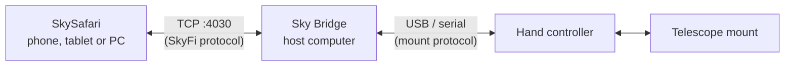

# Sky Bridge

Sky Bridge allows users to drive a telescope that only has a USB / serial
connector using [SkySafari][1]. It runs on just about any computer
that can connect to both the telescope mount and SkySafari's local WiFi network.

For example, on a Celestron telescope, the software opens the hand controller's 
USB/serial connection and also listens on TCP port 4030, which is how SkySafari 
talks to a SkyFi hardware box. SkySafari then connects to that port as if it 
were the SkyFi unit, passing data in both directions.



The software builds as one small binary with no dependencies, for Windows, macOS,
and Linux (including Raspberry Pi). Leave it running: unplugging the cable or
powering the mount off and on again is handled automatically.

## Install and Run

1. Download the archive for your operating system from the releases page.
2. Unpack it somewhere convenient. Inside is a single program, `skybridge`
   (`skybridge.exe` on Windows).
3. Run it. With no arguments it starts serving immediately:

```
$ skybridge
18:04:12 INFO listening addr=127.0.0.1:4030 mount=celestron-nexstar
18:04:12 INFO waiting for serial port mount=celestron-nexstar
18:04:40 INFO serial port opened path=/dev/cu.usbserial-110 baud=9600
```

See [docs/install.md](docs/install.md) for per-OS notes and for running
skybridge at login.

## Connect SkySafari

1. In SkySafari open **Settings → Telescope** and add or edit a preset.
2. Pick the **Scope Type** that matches your mount (for a Celestron hand
   controller, the NexStar entry) and the **Mount Type** (Alt-Az GoTo or
   Equatorial GoTo).
3. Choose **Wi-Fi** as the connection and turn off SkyFi auto-detection.
4. Enter the address and port: IP `127.0.0.1` when SkySafari runs on the
   same computer as skybridge, port `4030`.

If SkySafari runs on a phone or tablet, start skybridge with
`--listen 0.0.0.0:4030` and enter your computer's LAN address instead.
That exposes the mount to everything on your network; the protocol has no
password, so only do it on a network you trust.

Full walkthrough for SkySafari 6 and 7:
[docs/skysafari.md](docs/skysafari.md).

## Commands

| Command | What it does |
|---|---|
| `skybridge serve` | Relay the serial port to TCP. This is the default when no command is given. |
| `skybridge list-ports` | Show every serial port and which USB adapter is behind it. |
| `skybridge probe` | Talk to the mount and report which family it is. |
| `skybridge mounts` | List the mount profiles skybridge knows. |
| `skybridge version` | Print version and build information. |

`skybridge serve --help` lists the flags: `--port`, `--mount`, `--baud`,
`--listen`, `--verify`, `--log-level`, `--log-format`. Every flag can also
be set with an environment variable, `SKYBRIDGE_PORT` and so on, which is
handy under a service manager.

## More

- [Supported mounts and cables](docs/hardware.md)
- [Troubleshooting](docs/troubleshooting.md)
- [Development](docs/development.md)
- [Changelog](CHANGELOG.md)

Sky Bridge is released under the MIT License; see [LICENSE](LICENSE).

[1]:https://skysafariastronomy.com/
