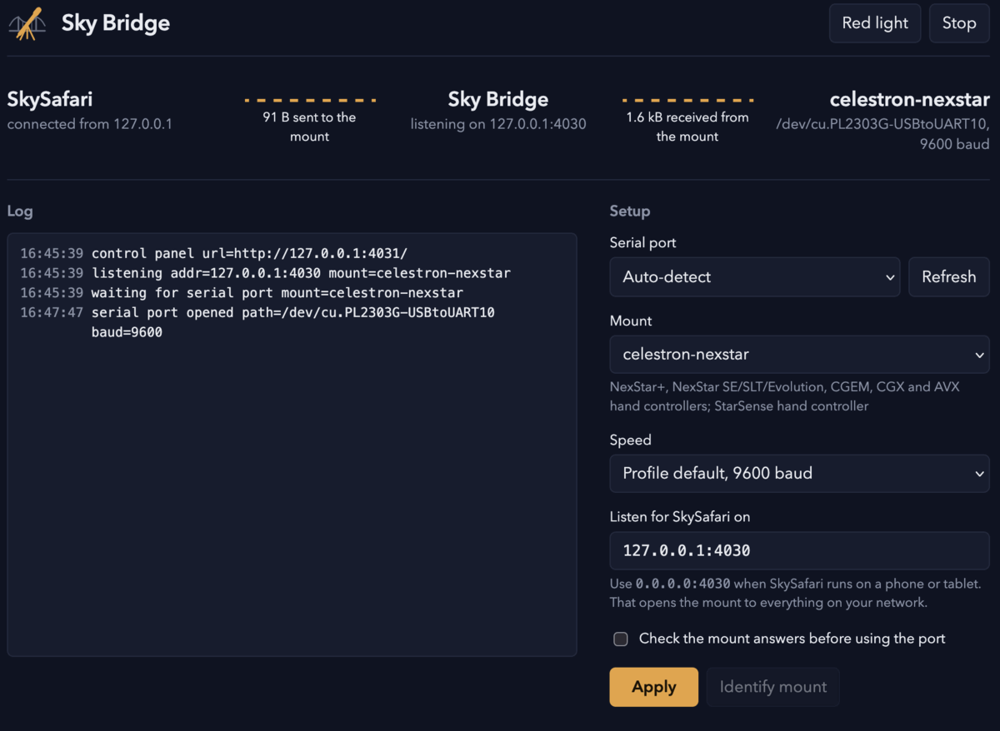

# The control panel

`skybridge gui` does everything `skybridge serve` does and also opens a
control panel in your browser:

```
$ skybridge gui
18:04:12 INFO control panel url=http://127.0.0.1:4031/
18:04:12 INFO listening addr=127.0.0.1:4030 mount=celestron-nexstar
```



The page shows the chain SkySafari, Sky Bridge, mount, and which links are
live. Under it is the log and, beside the log, the setup: serial port,
mount profile, speed, the address SkySafari connects to, and whether to
check the mount answers before the port is used. Apply saves the settings
and restarts the bridge if it is running. Identify mount asks whatever is
on the port which family it belongs to; the bridge has to be stopped first
because the mount only talks to one program at a time.

Settings are saved to the user's config directory
(`~/.config/skybridge/settings.json` on Linux,
`~/Library/Application Support/skybridge/settings.json` on macOS,
`%AppData%\skybridge\settings.json` on Windows). Flags and environment
variables given on the command line override them for that run.

Red light switches the page to reds on black, for dark-adapted eyes. The
browser remembers it.

## Flags

| Flag | What it does |
|---|---|
| `--port`, `--mount`, `--baud`, `--listen`, `--verify` | As for `serve`; they override the saved settings. |
| `--ui 127.0.0.1:4031` | Where to serve the panel. `0.0.0.0:4031` makes it reachable from a phone on the same network. |
| `--no-open` | Do not open a browser. The address is in the log. |

## On a Raspberry Pi or another headless box

Run `skybridge gui --ui 0.0.0.0:4031 --no-open` and open
`http://<the box's address>:4031/` from the phone or tablet that runs
SkySafari. The panel has no password, so do this only on a network you
trust: anyone who can reach it can start and stop the bridge and change
where it listens.
